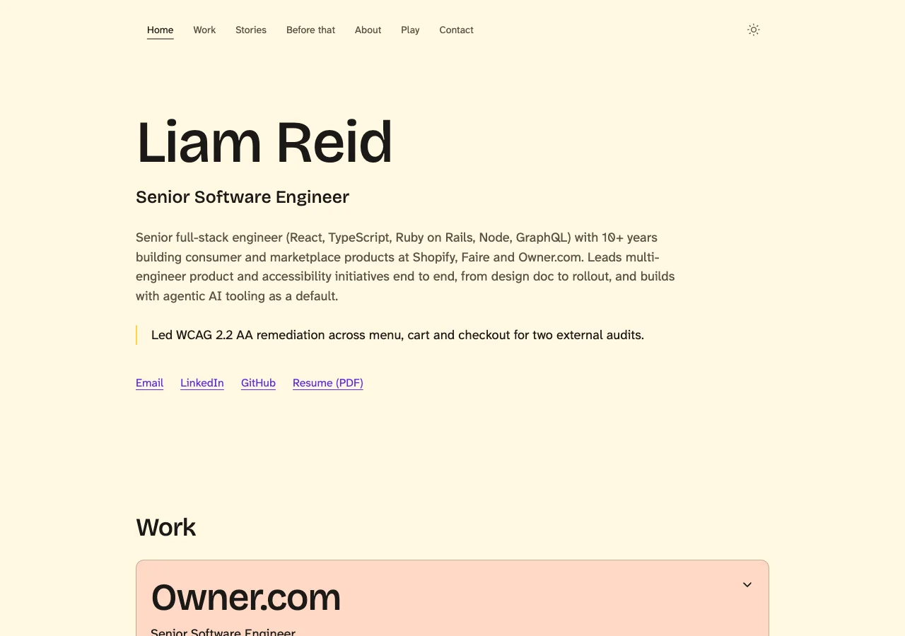
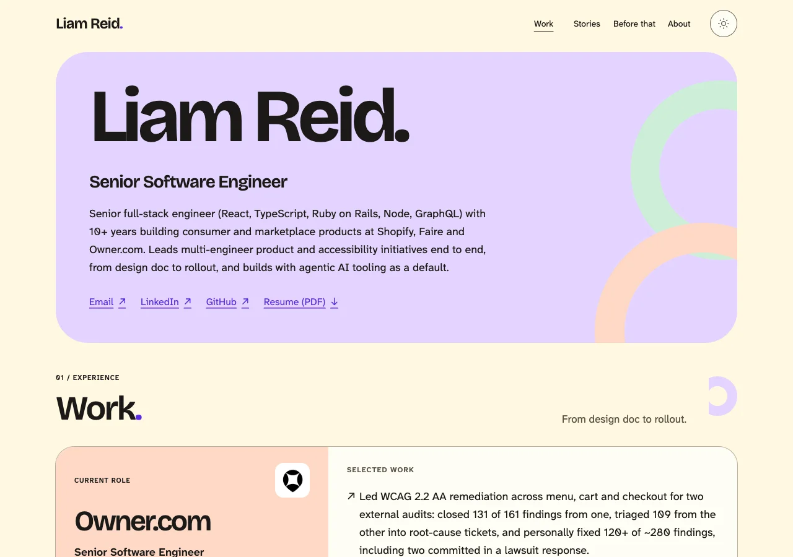
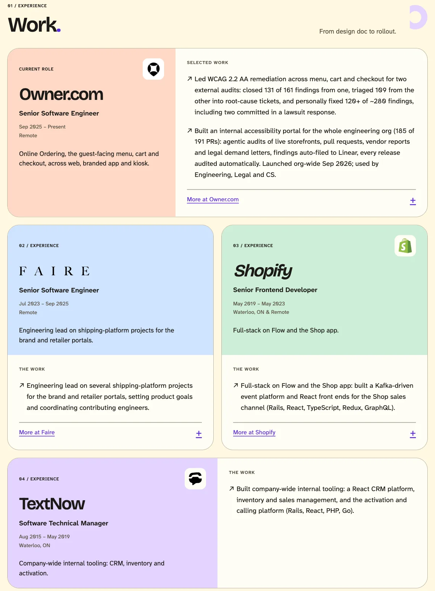
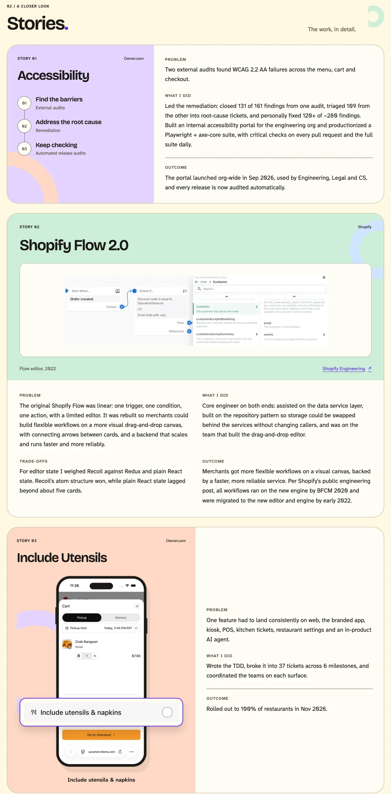
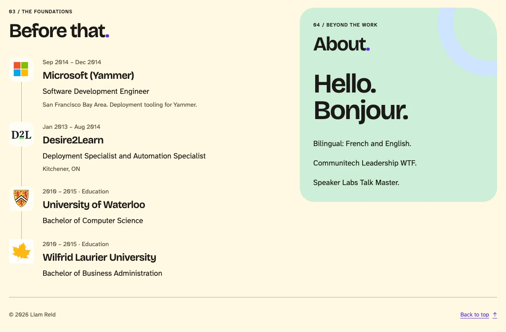
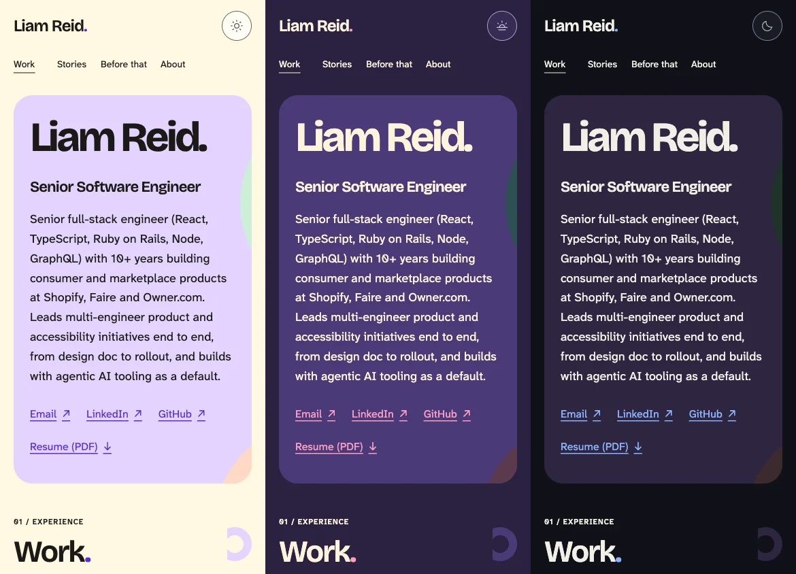

# Soft Current

Approved by Liam on 2026-11-10. The Site presents Liam Reid with confident type,
soft colour blocks and abstract moving arcs. There is no banana mascot. The
hero is left aligned and its former impact callout is removed.

## Reading and interaction

- Work shows the strongest Claims immediately. Native disclosures expose the
  remaining Claims. Faire and Shopify share grid rows, so their heights and
  colour breaks align even when one is expanded.
- Three Stories remain: Accessibility, Shopify Flow 2.0 and Include Utensils.
  Oversized numerical callouts and the Unified Client Cart State Story are
  removed. The existing staging Claim remains in the Owner Role, unchanged.
- The supplied cart screenshot sits inside a CSS phone frame. A second view
  of the same image enlarges the actual utensils row. There is no customer-site
  link or full-screenshot link, and no reconstructed product interface.
- Before that combines earlier Roles and education into a logo timeline.
  About retains its existing content. Play, the standalone accessibility
  statement and repeated Contact section are removed.
- Hero contact links remain available without JavaScript. The floating contact
  disclosure appears once those links have passed out of view. It opens on
  hover, keyboard focus or tap; Escape and outside click dismiss it. Cramped
  viewports place it in normal flow so it does not cover content or focus.

## Colour, type and motion

The existing checked day, dusk and night palette remains the source of truth.
The larger colour blocks make those tokens more prominent without adding
one-off UI colours. Self-hosted Bricolage Grotesque and Atkinson Hyperlegible
Next remain the only fonts. The favicon and Open Graph image now derive their
colours from `themes.css` at build time too.

The approved motion refinement adds one-time arrivals once content is visibly
inside the viewport. Work Cards lift with a short stagger, Story images and the
phone settle into place, and the utensils callout grows into its enlarged view.
Written Claims stay opaque and controls retain their full size. Keyboard focus
settles the relevant content; a pointer press pauses it until activation finishes.
Story imagery settles when a nearby link gains focus. Header arcs loop on offset
14- and 18-second cycles while the text remains
still; other arcs follow scrolling where CSS view timelines are supported.

Calm mode and system reduced motion each disable non-essential motion, including
an arrival already in progress. Without JavaScript, content and imagery keep
their final positions. A small IntersectionObserver module triggers arrivals;
all animation remains in `src/styles/motion.css`, using transform and opacity.

Keep the scroll animation properties as longhands. The production minifier
merged an animation shorthand with a view timeline into syntax Chromium did
not apply; explicit longhands preserve the intended production behaviour.
The browser suite checks real transform changes so a silent no-motion
regression cannot pass merely because content remains visible.

The refinement passes the full local gate suite, including 87 browser tests,
93 contrast pairs and Lighthouse 100/100/100/100 in three runs with LCP below
1 second. First-load JavaScript is 3,063 bytes gzipped. The original design
measurements and gallery below are retained as historical evidence.

Refinement screenshots show the layout, not the animation timing:
[header](soft-current-motion/hero.png) and [Work Cards](soft-current-motion/work.png).

## Image provenance

Assets were retrieved from the organisations' public sites on 2026-11-10 and
are served locally. Logos identify employers and universities; adjacent text
provides their names. Images have explicit dimensions and lazy loading.

| Asset | Public source | Preparation |
| --- | --- | --- |
| Owner symbol | [Owner](https://www.owner.com/) [web icon](https://cdn.prod.website-files.com/69b9330c8b70142e4e5f7d3c/69cfb253b5487b0fe93409bb_webclip.png) | Optimised PNG |
| Faire wordmark | [Faire logo](https://cdn.faire.com/static/logo.svg) | SVG; forced-colours text fallback |
| Shopify shopping bag | [Shopify brand assets](https://www.shopify.com/brand-assets) | Official full-colour SVG |
| TextNow symbol | [TextNow](https://www.textnow.com/) [symbol](https://a-us.storyblok.com/f/567278745139985/79x79/28d9090a7d/symbol-2026.svg) | Current official SVG |
| Microsoft symbol | [Microsoft](https://www.microsoft.com/en-ca/) [wordmark asset](https://uhf.microsoft.com/images/microsoft/RE1Mu3b.png) | PNG, CSS clips the wordmark to its symbol |
| D2L wordmark | [D2L logo](https://www.d2l.com/wp-content/uploads/2022/08/logo.svg) | SVG; employment name remains Desire2Learn |
| Waterloo crest | [University icon](https://uwaterloo.ca/profiles/uw_base_profile/themes/uw_fdsu_theme_resp/icon.svg) | SVG internal style declarations converted to presentation attributes for CSP compatibility |
| Laurier leaf | [University icon](https://www.wlu.ca/apple-touch-icon.png) | Optimised PNG |
| Flow editor | [Shopify Engineering, 2022](https://shopify.engineering/maestro-the-orchestration-language-powering-shopify-flow) [image](https://cdn.shopify.com/s/files/1/0779/4361/files/FlowAppEditor.png?v=1652735468) | 768×207 WebP, 18,748 bytes; caption identifies the historical editor |
| Utensils cart | Liam's supplied iPhone screenshot, 2026-11-10 | 940×2044 WebP, 50,828 bytes; one cached image used for full view and magnified row |

The phone frame and abstract arcs are CSS, not additional downloaded images.
Screenshot evidence below is documentation only and is not shipped in `dist`.

## Validation

Final local production build:

- `pnpm check`, `pnpm test` (23 tests), `pnpm build`, `pnpm budget`,
  `pnpm check:seo`, `pnpm axe` (82 tests), `pnpm lighthouse`, `pnpm linkcheck`
  and `pnpm check:launch` all pass.
- 93 contrast pairs pass unchanged thresholds. Lighthouse scores are
  100/100/100/100 in all three runs; LCP is 901.87, 902.10 and 903.21 ms.
- First-load JavaScript is 2,286 bytes gzipped against the 30,720-byte budget.
  There are no new runtime dependencies, third-party requests or CSP changes.
- Reviewed at 1280px and 390px in every theme with Calm on and off, settings
  open, Cards expanded, contact disclosure open, and forced-colours emulation.
  Reflow captures cover 640×400 and 320×256 CSS px. No overflow, failed images
  or page errors occurred in the final visual pass.

The existing Cloudflare Git integration automatically deployed commit `334f1fd`
from the unmerged PR branch to production. A separate Lighthouse run against
`https://bananajunk.dev/` also passed every threshold: 100/100/100/100 in all
three runs, with LCP of 958.01, 965.79 and 983.02 ms. These are lab measurements
of the live deployment, not field measurements.

Native browser zoom, real screen readers, real devices, Windows Contrast themes,
Safari and Firefox remain unverified for this design. See the
[accessibility testing record](../a11y-testing.md) for scope and manual steps.

## Before and after

Captured before changes from the live Site and after changes from the local
production build. Full-page after captures use Calm mode to show the static
composition; the state pass also covered Calm off.

| View | Before | After |
| --- | --- | --- |
| Day, 1280px | [Page](soft-current/before-day-1280-page.webp), [settings](soft-current/before-day-1280-settings.webp), [expanded Cards](soft-current/before-day-1280-roles.webp) | [Page](soft-current/after-day-1280-page.webp), [settings](soft-current/after-day-1280-settings.webp), [expanded Cards](soft-current/after-day-1280-roles.webp) |
| Dusk, 1280px | [Page](soft-current/before-dusk-1280-page.webp), [settings](soft-current/before-dusk-1280-settings.webp), [expanded Cards](soft-current/before-dusk-1280-roles.webp) | [Page](soft-current/after-dusk-1280-page.webp), [settings](soft-current/after-dusk-1280-settings.webp), [expanded Cards](soft-current/after-dusk-1280-roles.webp) |
| Night, 1280px | [Page](soft-current/before-night-1280-page.webp), [settings](soft-current/before-night-1280-settings.webp), [expanded Cards](soft-current/before-night-1280-roles.webp) | [Page](soft-current/after-night-1280-page.webp), [settings](soft-current/after-night-1280-settings.webp), [expanded Cards](soft-current/after-night-1280-roles.webp) |
| Day, 390px | [Page](soft-current/before-day-390-page.webp), [settings](soft-current/before-day-390-settings.webp), [expanded Cards](soft-current/before-day-390-roles.webp) | [Page](soft-current/after-day-390-page.webp), [settings](soft-current/after-day-390-settings.webp), [expanded Cards](soft-current/after-day-390-roles.webp) |
| Dusk, 390px | [Page](soft-current/before-dusk-390-page.webp), [settings](soft-current/before-dusk-390-settings.webp), [expanded Cards](soft-current/before-dusk-390-roles.webp) | [Page](soft-current/after-dusk-390-page.webp), [settings](soft-current/after-dusk-390-settings.webp), [expanded Cards](soft-current/after-dusk-390-roles.webp) |
| Night, 390px | [Page](soft-current/before-night-390-page.webp), [settings](soft-current/before-night-390-settings.webp), [expanded Cards](soft-current/before-night-390-roles.webp) | [Page](soft-current/after-night-390-page.webp), [settings](soft-current/after-night-390-settings.webp), [expanded Cards](soft-current/after-night-390-roles.webp) |

Additional captures: [mobile contact disclosure](soft-current/contact-mobile.webp),
[forced colours](soft-current/forced-colours.webp),
[400% equivalent reflow](soft-current/reflow-400.webp).
